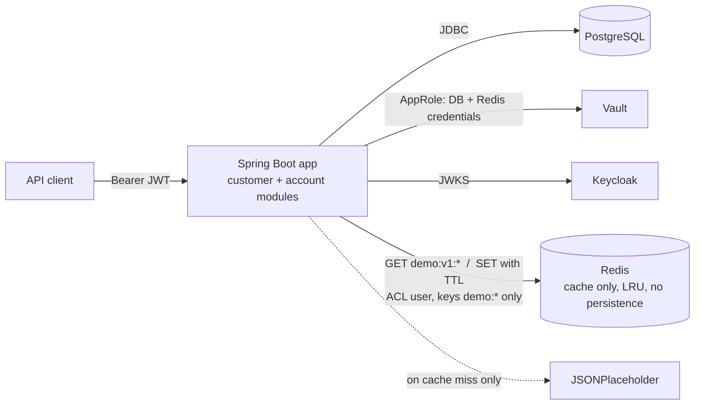

# ADR-0005: Cache customer-directory lookups in Redis

- Status: Accepted
- Date: 2026-11-04

## Context

`POST /api/v1/customers/imports` and `GET /api/v1/customers/{id}/posts` call the external
customer directory (JSONPlaceholder) on every request. A single import was measured at
~1.7 s, almost all of it downstream. The directory data changes rarely, is not ours, and is
read far more often than it changes.

Everything else the API reads comes from PostgreSQL by primary key or index (a few ms) or is
money (account balances), where a stale value is a correctness bug, not a performance issue.

The service must run as several instances behind a load balancer, so a cache filled by one
instance should serve the others, and must survive a restart of one instance.

## Options considered

1. **No cache**: keep calling the directory. Simple, but every request pays the downstream
   latency and every directory outage is our outage for these two endpoints.
2. **In-process cache (Caffeine)**: fastest (nanoseconds), no new infrastructure. But each
   instance keeps its own copy (N times the downstream calls, entries differ per instance),
   and the cache is empty after every deployment.
3. **Distributed cache (Redis) through Spring Cache**: one shared copy for all instances,
   survives deployments, TTL per cache, standard metrics. Adds a container to run and secure.
4. **Valkey** (BSD-licensed Redis fork): same protocol and same Spring client as option 3, a
   drop-in alternative if the Redis licence (RSALv2 / SSPLv1 / AGPLv3 since 8.0) is a concern
   for your organisation.

## Decision

Option 3: Redis via Spring Cache (`@Cacheable`) on the **directory adapter only**
(`customer.infrastructure.client.jsonplaceholder`). The application core does not know a
cache exists. Valkey stays a configuration-only swap (change the image).

| Cached | TTL | Why |
|---|---|---|
| `directory-users` (user by external id) | 30 min | Imports and retries of the same user |
| `directory-posts` (posts by user) | 5 min | Read on every `/posts` call |

Deliberately **not** cached:

| Not cached | Why |
|---|---|
| Customers, accounts from PostgreSQL | Primary-key reads are already a few ms; caching them adds invalidation across instances and stale reads after writes |
| Account balances, anything money | A stale balance is a wrong answer |
| Directory errors and "not found" | An exception is never cached, so a user created later in the directory is found on the next call |
| Null values | Disabled: a method that returns null is a bug to fix, not a value to remember |

Rules that come with it:

- **The cache is never required.** Redis errors are logged, counted (`cache.errors`) and
  treated as a miss: the request goes to the directory as if no cache existed. While Redis is
  disconnected, the client rejects commands immediately instead of waiting for the timeout.
- **Bounded.** Command timeout 250 ms, connect timeout 500 ms, `maxmemory` with `allkeys-lru`.
  Redis holds only cache data: no persistence, nothing that cannot be recomputed.
- **Least privilege.** The app logs in as its own ACL user, limited to keys `demo:*` and to
  read/write/connection commands (`FLUSHALL`, `KEYS`, `CONFIG` are denied). The credentials
  are in Vault (`secret/demo`) like the database ones. The `default` user is disabled.
- **Safe deserialisation.** Values are JSON with type information restricted to
  `com.mysample.demo.*` and `java.util.*`: a tampered entry cannot instantiate arbitrary classes.
- **Versioned keys.** `demo:v1:<cache>::<key>`. Bump `v1` when a cached class changes shape;
  old entries are then simply ignored until they expire.
- **Cache before resilience.** The caching advice runs outside retry and circuit breaker, so
  cached data is still served while the directory circuit is open.
- **Kill switch.** `SPRING_CACHE_TYPE=none` turns all caching off without a deployment.

## Consequences

- Positive: repeated directory reads drop from ~1-2 s to ~1 ms; a directory outage only
  affects data not yet cached; all instances share one cache.
- Positive: no change to domain, application or API code; removing the cache means removing
  two annotations and one configuration class.
- Negative: one more container to operate, patch and monitor in each environment (in
  production: a managed Redis/Valkey with TLS and HA, not this container).
- Negative: directory data can be up to one TTL old. Acceptable because the directory is an
  external reference, not our system of record; lower the TTL if that changes.
- Risk: cache stampede after expiry of a hot key. Mitigated per instance with
  `@Cacheable(sync = true)`; across instances, at most one directory call per instance per key.

## Container view after this decision

