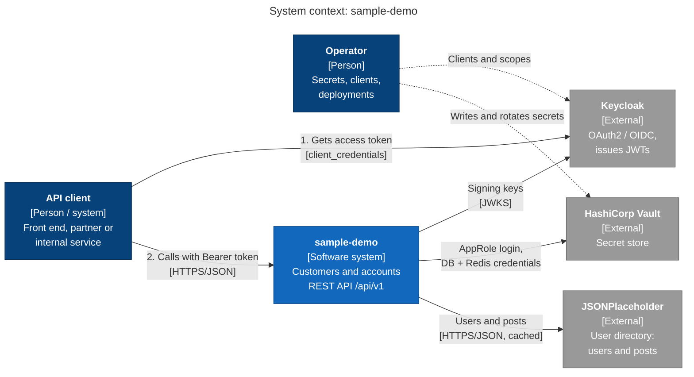
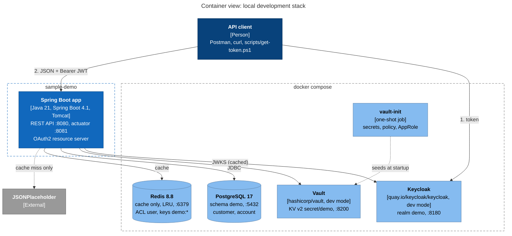
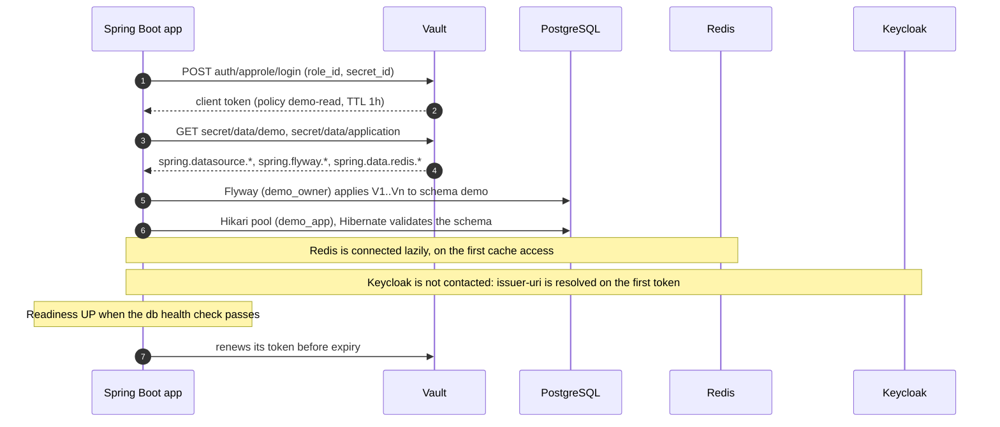
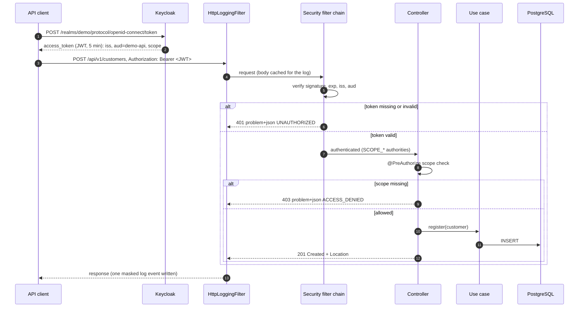
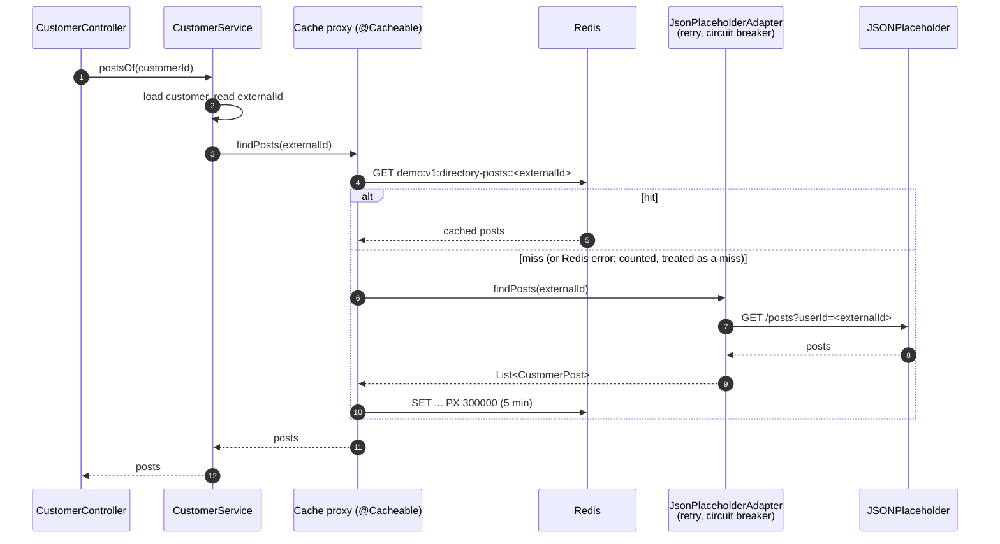
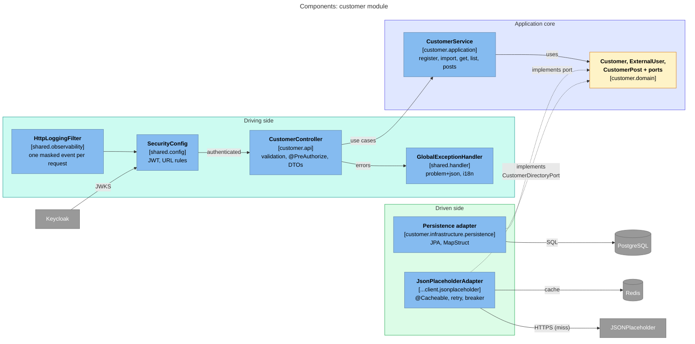
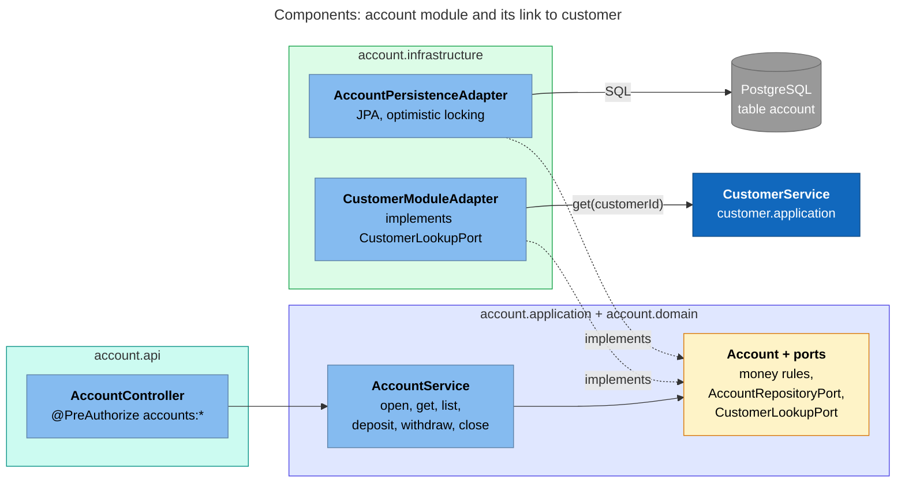
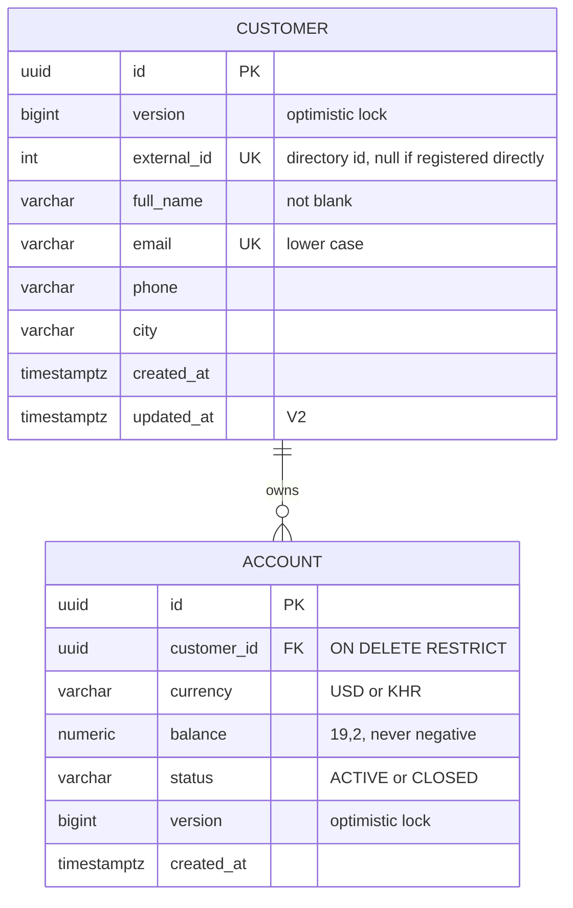

# Architecture: sample-demo

A single Spring Boot 4.1 / Java 21 service exposing a versioned REST API for **customers** and
their **accounts** (wallets). It is a modular monolith built as ports and adapters (hexagonal):
one module per business area (`customer`, `account`), shared technical building blocks in
`shared`.

Five rules shape everything below:

1. **No token, no API.** Every `/api/v1` call carries an OAuth2 access token (JWT) issued by
   Keycloak. The service is a stateless resource server: it validates tokens and checks scopes;
   it never issues tokens or keeps sessions.
2. **No credentials in configuration.** The service logs in to HashiCorp Vault (AppRole) at
   startup and receives its database and Redis credentials there.
3. **The domain depends on nothing.** HTTP, JPA, Redis and the external directory are adapters
   around a plain-Java core.
4. **Modules talk through application APIs.** `account` reaches `customer` only through
   `CustomerService`; no module reads another module's tables or entities. The database keeps
   them consistent with a foreign key.
5. **Optional things stay optional.** The cache, logging and metrics can fail without failing a
   request. Only PostgreSQL (and Vault at startup) are hard dependencies.

---

## Level 1: System context



PostgreSQL and Redis are owned by this system, so they appear at Level 2, not here.

## Level 2: Containers (local Docker Compose stack)



| Container | Role | Hard dependency? |
|---|---|---|
| PostgreSQL | System of record: `customer`, `account` (Flyway owns the schema) | Yes: readiness goes DOWN without it |
| Vault | Database and Redis credentials, read once at startup | At startup only |
| Keycloak | Issues tokens; the app only fetches its signing keys | For new tokens and key refresh |
| Redis | Cache of directory lookups only | **No**: errors become cache misses |
| JSONPlaceholder | External user directory | Only for `/imports` and `/{id}/posts` |

### Startup sequence



### Request sequence: token first, then the API



### Request sequence: cached directory read



The cache sits outside retry and circuit breaker: a hit never reaches them, and cached data is
still served while the directory circuit is open.

---

## Security

### Authentication: JWT resource server

| Check | Source of truth | Fails with |
|---|---|---|
| Signature | Keycloak JWKS (OIDC discovery, cached) | 401 |
| `exp` | token (local tokens live 5 minutes) | 401 |
| `iss` | `spring.security.oauth2.resourceserver.jwt.issuer-uri` | 401 |
| `aud` contains `demo-api` | `spring.security.oauth2.resourceserver.jwt.audiences` | 401 |

Stateless: `SessionCreationPolicy.STATELESS`, no cookies, CSRF disabled (no cookie to forge).

### Authorization: scopes

Scopes in the `scope` claim become `SCOPE_*` authorities. Each endpoint declares its own rule
with `@PreAuthorize`; `SecurityConfig` only separates public from protected paths.

| Scope | Grants |
|---|---|
| `customers:read` | `GET` customer endpoints |
| `customers:write` | register and import customers |
| `accounts:read` | `GET` account endpoints |
| `accounts:write` | open and close accounts, deposit, withdraw |
| `ops:read` | actuator endpoints that are not public |

Public without a token: `/actuator/health/**`, `/actuator/info`, `/actuator/prometheus`,
`/v3/api-docs/**`, `/swagger-ui/**`, and Boot's error dispatch (so a 500 is never masked as an
empty 401). Prometheus must also be kept off the public ingress.

### Local realm (`docker/keycloak/realm-demo.json`)

| Client | Grant | Scopes in the token |
|---|---|---|
| `demo-service` | client_credentials | `customers:* accounts:*` (+ `ops:read` on request) |
| `demo-readonly` | client_credentials | `customers:read accounts:read` |

Both add `demo-api` to `aud` through an audience mapper.

### Profiles and filter chains

| Profile | Chain |
|---|---|
| `local` (default of `bootRun`), `uat`, `prod` | JWT resource server, one issuer per environment |
| `noauth` (opt-in, laptops only) | no authentication; anonymous caller gets every business scope |

Exactly one chain is active (`@Profile("!noauth")` / `@Profile("noauth")`), so the app can never
fall back to Spring Boot's default form-login chain.

### Errors from the filter chain

401 and 403 are routed by `shared.error.security` to `GlobalExceptionHandler`: same
problem+json shape, `errorCode`, `traceId` and `api.errors` metric as every other error. The
precise token failure is only in `WWW-Authenticate` and the debug log.

---

## Level 3: Components

### Customer module and shared building blocks



### Account module



## Module boundaries

| Package | Responsibility | May depend on |
|---|---|---|
| `customer.domain` | `Customer`, `ExternalUser`, `CustomerPost`, business exceptions, ports | JDK, `shared.error` |
| `customer.application` | `CustomerService`, `ImportResult`: use cases, transactions | `customer.domain` |
| `customer.api` | `CustomerController`, DTOs, `CustomerApiMapper` | `customer.application`, `customer.domain` |
| `customer.infrastructure.persistence` | JPA entity, repository, adapter | `customer.domain` |
| `customer.infrastructure.client.jsonplaceholder` | HTTP interface, tolerant-reader DTOs, `JsonPlaceholderAdapter`, `DirectoryCaches` | `customer.domain` |
| `account.domain` | `Account` (money rules), exceptions, `AccountRepositoryPort`, `CustomerLookupPort` | JDK, `shared.error` |
| `account.application` | `AccountService` | `account.domain` |
| `account.api` | `AccountController`, DTOs, `AccountApiMapper` (MapStruct) | `account.application`, `account.domain` |
| `account.infrastructure.persistence` | JPA entity, repository, adapter | `account.domain` |
| `account.infrastructure.customer` | `CustomerModuleAdapter` | `account.domain`, `customer.application` |
| `shared.config` | `SecurityConfig`, HTTP client config | Spring |
| `shared.cache` | `CacheConfig`, `AppCacheProperties`, `MeteredCacheErrorHandler` | Spring, Spring Data Redis |
| `shared.error` | `ErrorCode`, exception hierarchy, 401/403 handlers | JDK (exceptions), Spring (handlers) |
| `shared.handler` | `GlobalExceptionHandler`, `ProblemDetailFactory` | Spring |
| `shared.observability` | `HttpLoggingFilter`, `SensitiveDataMasker`, `DownstreamLoggingInterceptor` | Spring, SLF4J |
| `shared.mapping`, `shared.model`, `shared.pagging` | MapStruct policies, shared types, paging | - |

Rules:

- Dependencies point inward: `api` / `infrastructure` → `application` → `domain`.
- The domain never imports Spring, JPA, HTTP, Redis or adapter classes.
- DTOs never leave `*.api`; JPA entities never leave `*.infrastructure.persistence`.
- Authorization is decided at the API edge; use cases never read the token.
- Between modules, only `account.infrastructure.customer` imports from `customer`, and only
  `customer.application`.

---

## Data model

Flyway owns the schema (`src/main/resources/db/migration`); Hibernate only validates it.



| Migration | Change |
|---|---|
| `V1__create_customer.sql` | `customer`, unique email and external id, checks, index `(created_at DESC, id)` for the list |
| `V2__alter_customer.sql` | `updated_at`, added with a default and back-filled (safe during a rolling deployment) |
| `V3__create_account.sql` | `account`, FK to `customer`, balance check, partial unique index (one ACTIVE account per currency) |

Rule: a released migration is never edited or renamed. A schema change is a new `V<n+1>`.

| Rule | Domain | Database |
|---|---|---|
| One customer per email / per directory user | `DUPLICATE_CUSTOMER` (409) | `uq_customer_email`, `uq_customer_external_id` |
| Balance never negative | `INSUFFICIENT_FUNDS` (422) | `ck_account_balance_not_negative` |
| One ACTIVE account per customer and currency | n/a | `uq_account_customer_currency_active` → 409 `ACCOUNT_ALREADY_EXISTS` |
| Account belongs to an existing customer | `CustomerLookupPort` → 404 | `fk_account_customer` |
| Customer with accounts cannot be deleted | n/a | `ON DELETE RESTRICT` |
| Amount positive, at most two decimals | `INVALID_AMOUNT` (422), `@Digits(17,2)` (400) | `NUMERIC(19,2)` |
| Only an empty account can be closed | `ACCOUNT_BALANCE_NOT_ZERO` (422) | n/a |
| Concurrent changes never overwrite each other | n/a | `version` + `@Version` → 409 `CONCURRENT_MODIFICATION` |

Money is `BigDecimal` / `NUMERIC`, never `double`.

---

## Caching

Decision and alternatives: [ADR-0005](adr/0005-redis-cache-for-directory-lookups.md).

| Cache | Key | TTL |
|---|---|---|
| `directory-users` | `demo:v1:directory-users::<externalId>` | 30 min |
| `directory-posts` | `demo:v1:directory-posts::<externalId>` | 5 min |

- Only directory data is cached, on the adapter. Customers, accounts and balances are never
  cached; exceptions and nulls are never cached.
- Values are JSON with type information restricted to `com.mysample.demo.*` and `java.util.*`.
- Redis user `demo` (ACL): keys `demo:*` only; `FLUSHALL`, `KEYS`, `CONFIG` denied. Use `SCAN`.
- Redis errors are logged, counted in `cache.errors` and treated as misses. While disconnected,
  commands are rejected at once (no added latency); command timeout 250 ms.
- `@Cacheable(sync = true)`: one directory call per key per instance after an expiry.
- Kill switch: `SPRING_CACHE_TYPE=none`. Bump `v1` in `app.cache.key-prefix` when a cached class
  changes shape.

## Observability

| Signal | Where | Notes |
|---|---|---|
| HTTP traffic | `HttpLoggingFilter`, one event per request/response | Runs before Spring Security (logs 401/403). Credentials masked (`Bearer ****`, `password`, `*secret*`, `*token*`), e-mail and phone partially masked, line breaks removed (no log forging), bodies above `max-body-length` not logged |
| Log format | ECS JSON on the console (`logging.structured.format.console: ecs`) | One line per event, `traceId` on every line; plain text locally via an override in `application-local.yml` |
| Log files (local) | `logs/demo.log`, `logs/http.log`, hourly into `logs/archive/*.log.gz` | `logback-spring.xml`; files are a laptop convenience, platforms collect stdout |
| Metrics | `/actuator/prometheus` (:8081) | `http.server.requests`, `api.errors{errorCode,status}`, `cache.gets{result}`, `cache.errors`, `hikaricp.*`, `resilience4j.*` |
| Tracing | `traceId` in MDC, in every problem+json and log line | Give the `traceId` of an error response to support |
| Health | `/actuator/health/readiness` (db), `/liveness` | Redis and the directory are deliberately not in readiness |

| Profile | `app.http-logging` |
|---|---|
| `local` | `pretty: true`, headers and bodies |
| `uat`, `prod` | compact one line, no headers, no bodies (bodies hold personal data) |

---

## Token API (Keycloak)

Step 1 of every call. This endpoint belongs to Keycloak; the API only validates what it returns.
Do not proxy it through the API: client secrets would pass through the application.

| Item | Value |
|---|---|
| Method / URL (local) | `POST http://127.0.0.1:8180/realms/demo/protocol/openid-connect/token` |
| URL (any environment) | `{issuer}/protocol/openid-connect/token`, or `token_endpoint` from `{issuer}/.well-known/openid-configuration` |
| Content-Type | `application/x-www-form-urlencoded` (JSON is rejected) |
| Parameters | `grant_type=client_credentials`, `client_id`, `client_secret`, optional `scope` (e.g. `ops:read`) |

Response `200`:

```json
{
  "access_token": "eyJhbGciOiJSUzI1NiIsInR5cCIgOiAiSldUIiwia2lkIiA6ICIuLi4ifQ...",
  "expires_in": 300,
  "token_type": "Bearer",
  "scope": "customers:read customers:write accounts:read accounts:write"
}
```

No refresh token with `client_credentials`: reuse the token until shortly before `expires_in`,
then request a new one. Never retry a 401 with the same token.

| Keycloak error | Cause |
|---|---|
| `invalid_request` (400) | Missing `grant_type`, or JSON body instead of form data |
| `invalid_scope` (400) | Scope not allowed for this client |
| `invalid_client` / `unauthorized_client` (401) | Wrong client id or secret |

---

## API contract

Every endpoint requires `Authorization: Bearer <access token>`. Base path `/api/v1`.

### Customers

| Method | Path | Scope | Success | Errors |
|---|---|---|---|---|
| `POST` | `/customers` | `customers:write` | `201` + `Location` | `400`, `409` `DUPLICATE_CUSTOMER`, `422` `CUSTOMER_RULE_VIOLATION` |
| `POST` | `/customers/imports` | `customers:write` | `201` + `Location` (new), `200` (already imported) | `400`, `404` `EXTERNAL_USER_NOT_FOUND`, `409`, `502` `DOWNSTREAM_REJECTED`, `503` `DOWNSTREAM_UNAVAILABLE` |
| `GET` | `/customers/{id}` | `customers:read` | `200` | `404` `CUSTOMER_NOT_FOUND` |
| `GET` | `/customers?page=0&size=20` | `customers:read` | `200` page, newest first; `size` 20-100 (see [Known gaps](#known-gaps)) | `400` |
| `GET` | `/customers/{id}/posts` | `customers:read` | `200` (cached 5 min) | `404`, `502`, `503` |

Bodies: register `{"fullName","email","phone","city"}`; import `{"externalUserId": 2}`.

### Accounts

| Method | Path | Scope | Success | Errors |
|---|---|---|---|---|
| `POST` | `/customers/{customerId}/accounts` | `accounts:write` | `201` + `Location` | `400`, `404` customer, `409` `ACCOUNT_ALREADY_EXISTS`, `422` `UNSUPPORTED_CURRENCY` |
| `GET` | `/customers/{customerId}/accounts` | `accounts:read` | `200` list, oldest first, closed included | `404` customer |
| `GET` | `/accounts/{accountId}` | `accounts:read` | `200` | `404` `ACCOUNT_NOT_FOUND` |
| `POST` | `/accounts/{accountId}/deposits` | `accounts:write` | `200` account | `400`, `404`, `409` `CONCURRENT_MODIFICATION`, `422` `INVALID_AMOUNT` / `ACCOUNT_NOT_ACTIVE` |
| `POST` | `/accounts/{accountId}/withdrawals` | `accounts:write` | `200` account | as deposits, plus `422` `INSUFFICIENT_FUNDS` |
| `POST` | `/accounts/{accountId}/close` | `accounts:write` | `200` account | `404`, `409`, `422` `ACCOUNT_BALANCE_NOT_ZERO` / `ACCOUNT_NOT_ACTIVE` |

Bodies: open `{"currency": "USD"}` (USD or KHR); deposit and withdraw `{"amount": 10.50}`.
Every endpoint can also return `401` and `403`.

### Errors

`application/problem+json` (RFC 9457) with `type`, `title`, `status`, `detail`, `instance`,
`errorCode`, `traceId`, `timestamp`; `errors[]` on validation failures. `title`/`detail` follow
`Accept-Language` (`km`, English default); `errorCode` never changes, so clients branch on it.

| Status | `errorCode` |
|---|---|
| 400 | `VALIDATION_FAILED`, `MALFORMED_REQUEST` |
| 401 / 403 | `UNAUTHORIZED` / `ACCESS_DENIED` |
| 404 | `CUSTOMER_NOT_FOUND`, `EXTERNAL_USER_NOT_FOUND`, `ACCOUNT_NOT_FOUND`, `ROUTE_NOT_FOUND` |
| 405 / 406 / 415 | `METHOD_NOT_ALLOWED`, `NOT_ACCEPTABLE`, `UNSUPPORTED_MEDIA_TYPE` |
| 409 | `DUPLICATE_CUSTOMER`, `ACCOUNT_ALREADY_EXISTS`, `CONCURRENT_MODIFICATION` (reload and retry) |
| 422 | `CUSTOMER_RULE_VIOLATION`, `INSUFFICIENT_FUNDS`, `INVALID_AMOUNT`, `ACCOUNT_NOT_ACTIVE`, `ACCOUNT_BALANCE_NOT_ZERO`, `UNSUPPORTED_CURRENCY` |
| 502 / 503 | `DOWNSTREAM_REJECTED` / `DOWNSTREAM_UNAVAILABLE` (`Retry-After: 30`) |
| 500 | `INTERNAL_ERROR` (details only in the log) |

---

## Failure behaviour

| Dependency down | Effect |
|---|---|
| Vault at startup | App refuses to start (`fail-fast`). No fallback to defaults. |
| Vault after startup | Keeps working (credentials in memory); token renewal retried. |
| PostgreSQL | Requests fail fast (5 s connection timeout); readiness DOWN, liveness UP. |
| Keycloak | Existing tokens keep validating while keys are cached; no new tokens. App starts without it. |
| Redis | Requests still succeed, uncached (directory calls ~1-2 s). No added latency; `cache.errors` rises; readiness unaffected. |
| JSONPlaceholder | Only `/imports` and `/{id}/posts`; cached data still served; otherwise retry (transient only), circuit breaker, `503` + `Retry-After`. |
| Slow query | `statement_timeout` 30 s (DB role), JDBC `socketTimeout` 60 s, transaction timeout 10 s. |

## Known gaps

| # | Gap | Risk | Next step |
|---|---|---|---|
| 1 | Deposits and withdrawals are not idempotent | A client retry after a timeout moves money twice | `account_transaction` ledger with a unique `Idempotency-Key` |
| 2 | `GET /customers`: `@Min(20)` on `size` | `?size=10` returns 400 | `@Min(1)` (one-line fix) |
| 3 | Authorization is scope-only | Fine for machine clients; with end-user tokens, one user could read another's data | Ownership check (`sub` ↔ customer) in the use case |
| 4 | Few automated tests for security, persistence and migrations | Regressions found by hand | `@WebMvcTest` + `jwt()`, Testcontainers PostgreSQL and Redis in CI |
| 5 | HTTP log lacks caller identity, route template, `errorCode` | Slower investigations | Add `client.id` (`azp`), `http.route`, `error.code` fields |

## Decisions

| ADR | Decision |
|---|---|
| [0001](adr/0001-database-credentials-in-vault.md) | Database credentials in Vault, not in configuration |
| [0002](adr/0002-approle-authentication.md) | AppRole authentication to Vault |
| [0003](adr/0003-separate-owner-and-app-database-roles.md) | Separate schema-owner and application database roles |
| [0004](adr/0004-package-by-feature-layering.md) | Package by feature, layered inside |
| [0005](adr/0005-redis-cache-for-directory-lookups.md) | Redis cache for directory lookups only |
